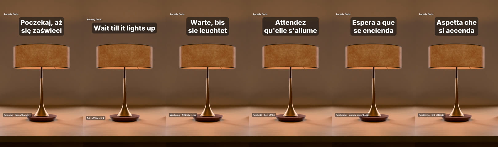
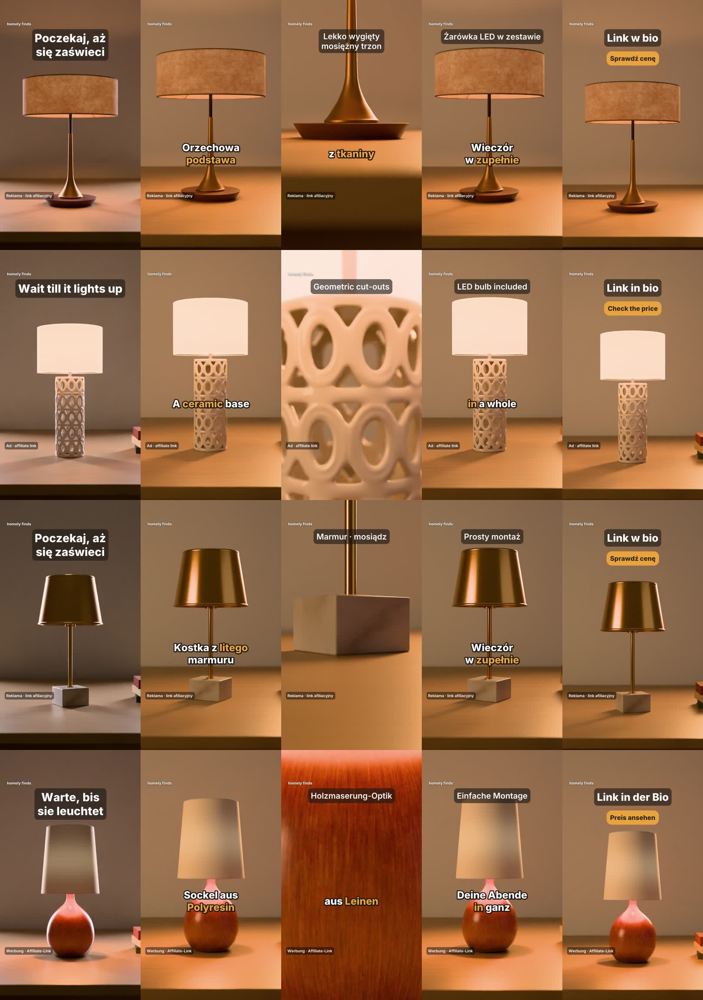

# Fabryka rolek sprzedażowych — wyniki i postęp prac

Stan na 16.10.2026, gałąź `ccr-385634d5-fko2x8`. Raport w PDF: [PODSUMOWANIE.pdf](PODSUMOWANIE.pdf).

System sam robi pionowe rolki sprzedażowe (9:16, 12 s), bez agenta i bez ręcznej pracy. Wejście to prawdziwy produkt:
fakty z katalogu i jego model 3D. Na wyjściu dostajesz gotowe MP4 dla wielu języków i platform, z lektorem,
muzyką, napisami, CTA i oznaczeniem reklamy. Rolki w tym folderze to przykłady w lżejszej wersji 720×1280 (do
oglądania w przeglądarce). System renderuje 1080×1920.

## Co system potrafi już stworzyć

- **Prawdziwy produkt w studiu 3D** (Blender). To katalogowy model 3D z jego materiałami, a nie wygenerowany obraz.
  Studio ma 21 typów ujęć: włączenie światła, obrót, zbliżenie detalu, przejazd kamery, ujęcie CTA.
- **Kopia sprzedażowa oparta na faktach** w strukturze hook → korzyść → dowód → pragnienie → CTA. Każde
  zdanie musi wynikać z faktów produktu. Zmyślone liczby, kolory, opinie klientów, „darmowa dostawa” czy „tylko
  dziś” są blokowane.
- **6 języków**: PL, EN, DE, FR, ES, IT, z jednego mastera wideo. Każdy język ma natywnie napisaną kopię, własnego
  lektora i własne napisy słowo po słowie.
- **3 platformy**: TikTok, Instagram Reels, YouTube Shorts. Tekst i logo omijają strefy interfejsu każdej z nich.
- **Testy A/B hooków** prawie za darmo: to samo wideo, inny hook.
- **Automatyczna kontrola jakości** każdej rolki. Sprawdza technikę, głośność, widoczność produktu, czytelność
  tekstu, CTA, obecność oznaczenia reklamy i kolor produktu. Jeśli da się coś naprawić automatycznie, poprawia
  i renderuje ponownie.
- **Oznaczenie reklamy / linku afiliacyjnego** w każdej rolce i w każdym języku. Pisze je kod, nigdy model AI.
- **Koszt i zwrot liczone per rolka.** Dostajesz koszt API, koszt czasu maszyny i liczbę sprzedaży potrzebną do
  zwrotu.

## Przykładowe rolki

| # | Rolka | Kadry |
|---|---|---|
| 01 | [Lampa orzech + mosiądz — PL, TikTok](rolki/01_lampa-orzech-mosiadz_PL_TikTok.mp4) | [klatki](klatki/01_lampa-orzech-mosiadz_PL_TikTok.jpg) |
| 02 | [Ta sama lampa — EN, Instagram](rolki/02_lampa-orzech-mosiadz_EN_Instagram.mp4) | [klatki](klatki/02_lampa-orzech-mosiadz_EN_Instagram.jpg) |
| 03 | [Ta sama lampa — DE, TikTok](rolki/03_lampa-orzech-mosiadz_DE_TikTok.mp4) | [klatki](klatki/03_lampa-orzech-mosiadz_DE_TikTok.jpg) |
| 04 | [Ta sama lampa — FR, TikTok](rolki/04_lampa-orzech-mosiadz_FR_TikTok.mp4) | [klatki](klatki/04_lampa-orzech-mosiadz_FR_TikTok.jpg) |
| 05 | [Ta sama lampa — ES, TikTok](rolki/05_lampa-orzech-mosiadz_ES_TikTok.mp4) | [klatki](klatki/05_lampa-orzech-mosiadz_ES_TikTok.jpg) |
| 06 | [Ta sama lampa — IT, TikTok](rolki/06_lampa-orzech-mosiadz_IT_TikTok.mp4) | [klatki](klatki/06_lampa-orzech-mosiadz_IT_TikTok.jpg) |
| 07a | [Test A/B — wariant A (hook „Poczekaj, aż się zaświeci”)](rolki/07a_test-AB_wariant-A_hook-poczekaj-az-sie-zaswieci_PL.mp4) | [klatki](klatki/07a_test-AB_wariant-A_hook-poczekaj-az-sie-zaswieci_PL.jpg) |
| 07b | [Test A/B — wariant B (hook „problem”)](rolki/07b_test-AB_wariant-B_hook-problem_PL.mp4) | [klatki](klatki/07b_test-AB_wariant-B_hook-problem_PL.jpg) |
| 08 | [Lampa ceramiczna z ażurem — PL, TikTok](rolki/08_lampa-ceramiczna-azur_PL_TikTok.mp4) | [klatki](klatki/08_lampa-ceramiczna-azur_PL_TikTok.jpg) |
| 09 | [Lampa ceramiczna — EN, Instagram](rolki/09_lampa-ceramiczna-azur_EN_Instagram.mp4) | [klatki](klatki/09_lampa-ceramiczna-azur_EN_Instagram.jpg) |
| 10 | [Lampa marmur + mosiądz — PL, TikTok](rolki/10_lampa-marmur-mosiadz_PL_TikTok.mp4) | [klatki](klatki/10_lampa-marmur-mosiadz_PL_TikTok.jpg) |
| 11 | [Lampa z żywicy, klosz lniany — DE, Instagram](rolki/11_lampa-zywica-len_DE_Instagram.mp4) | [klatki](klatki/11_lampa-zywica-len_DE_Instagram.jpg) |

Rolki 07a i 07b wyrenderowałem wcześniej, przed ostatnimi poprawkami kadru i logo. Pokazują sam mechanizm A/B.

Cztery prawdziwe lampy z katalogu (Amazon Berkeley Objects, CC BY 4.0), klatki: hook → korzyść → zbliżenie detalu → pragnienie → CTA:

### W toku: meble (to nie są jeszcze rolki do publikacji)

| # | Rolka | Co jeszcze nie działa |
|---|---|---|
| 12 | [Fotel obrotowy — PL](rolki_w_toku_meble/12_W-TOKU_fotel-obrotowy_PL.mp4) | Kopia jest ogólnikowa (brak koncepcji dla mebli). Zbliżenie pokazuje płaską tkaninę. Ta rolka powstała jeszcze przed poprawką podłogi, więc fotel stoi na blacie |
| 13 | [Sofa — PL](rolki_w_toku_meble/13_W-TOKU_sofa_PL.mp4) | Stoi już na podłodze, ale w kadrze 9:16 zajmuje tylko 21% wysokości. Kopia jest ogólnikowa |

## Wyniki testów

- **Ostatni batch katalogowy** (4 lampy × 3 języki × 2 platformy): **24/24 rolki przeszły QA**. TikTok: 100 pkt, Instagram: 97–100 pkt, 0 błędów.
- **FR / ES / IT**: 3/3 rolki, QA 100.
- **Koszt**: API $0 (tryb lokalny ECONOMY). Komputer: około **$0,005 za rolkę** przy renderze od zera. Przy prowizji $3 koszt zwraca się po 1 sprzedaży.
- **Czas**: nowy produkt (6 rolek) zajmuje ok. 11 min, z czego większość to render 3D. Gdy rendery są w cache, 6 rolek
  powstaje w **2 min 53 s**. Każda dodatkowa wersja językowa lub platformowa to 14–18 s.
- **Jakość kodu**: 477 testów jednostkowych i 64 testy studia Blender przechodzą, typecheck i lint są czyste.
  Przegląd adwersaryjny znalazł 26 błędów i 5 problemów bezpieczeństwa; wszystkie są naprawione.

## Postęp prac (szacunek)

| Obszar | Postęp | Stan |
|---|---:|---|
| Architektura, kontrakty, konfiguracja (modele tylko z ENV) | 100% | gotowe |
| Studio produktowe Blender (prawdziwy model 3D, 21 ujęć, cache) | 90% | gotowe dla lamp; meble stoją już na podłodze |
| Montaż FFmpeg, napisy, tekst, logo, głośność | 95% | gotowe |
| Audio: lektor w 6 językach, muzyka, efekty, ducking | 85% | działa lokalnie; Lyria / TTS w chmurze niesprawdzone na żywo |
| Reżyser, hooki, leksykon sprzedażowy | 75% | lampy kompletne; meble w toku |
| Wielojęzyczność PL/EN/DE/FR/ES/IT | 95% | wszystkie 6 języków sprawdzone na rolkach |
| QA + automatyczne poprawki | 90% | gotowe |
| Walidacja twierdzeń, oznaczenie reklamy, bezpieczeństwo | 95% | gotowe |
| Koszty i zwrot (budżety, koszt/rolkę, A/B, wiele platform) | 95% | gotowe |
| Warstwa Google AI (Gemini, Lyria, TTS, Veo) | 75% | kod i testy na atrapach; na żywo niesprawdzone (bez klucza, bez wydatków) |
| Produkcja masowa (batch katalogu, kolejka, worker, baza) | 75% | batch działa; kolejka i baza niesprawdzone na żywo |
| Pokrycie katalogu (kategorie produktów) | 35% | lampy gotowe; meble ok. 20%; inne kategorie 0% |
| Dokumentacja | 90% | `docs/REEL_FACTORY.md` |
| **Całość** | **ok. 84%** | średnia z 13 obszarów |

Publikowanie w mediach społecznościowych jest celowo wyłączone (zasada: nic nie publikujemy) i nie wchodzi do wyliczenia.

## Co dalej

1. Dokończyć meble. To największy kawałek katalogu ABO z modelami 3D: ok. 1200 krzeseł i 860 sof.
   - Gotowe: analiza 240 prawdziwych listingów w 6 podkategoriach.
   - Do zrobienia: koncepcje kopii, kadr dla szerokich sof, zbliżenia tkanin.
2. Uruchomić na żywo tier STANDARD z Google AI. Wymaga klucza i Twojej zgody na koszt rzędu centów za rolkę.
3. Puścić batch 20–50 produktów z zapisem do bazy i zbieraniem wyników publikacji, żeby wybór hooków uczył się z
   prawdziwych danych.

## Przykład śladu audytowego

Każda rolka ma manifest. Zapisani są w nim dostawcy, ujęcia, czasy, koszt, fallbacki i wynik QA, a do tego plan,
z którego powstała, i raport joba:
[manifest](przyklad_manifestu/manifest_lampa_PL_TikTok.json) ·
[plan](przyklad_manifestu/plan_lampa_PL_TikTok.json) ·
[raport joba](przyklad_manifestu/raport_joba_lampa.md).
